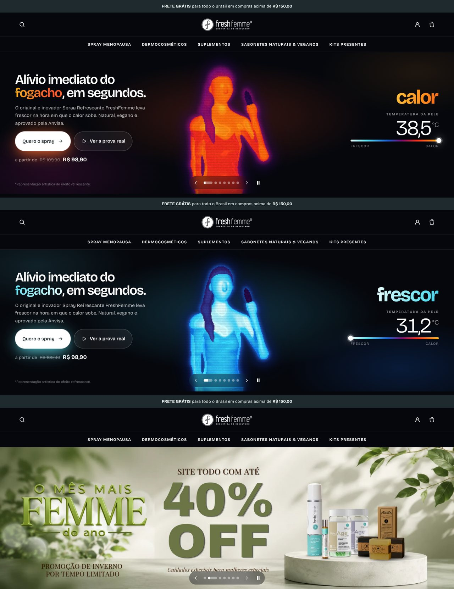

# FreshFemme Thermal — tema Shopify

Tema novo para a loja [freshfemme.com.br](https://freshfemme.com.br), feito do zero para a Shopify (Online Store 2.0).
A capa é uma câmera térmica em 3D: uma mulher aparece em vermelho/laranja (o fogacho), borrifa o spray no
pescoço e o azul gelado vai descendo pelo corpo, com a temperatura caindo no visor.

O resto segue a identidade e a estrutura da loja atual: uma fonte só, a **Bricolage Grotesque** que a loja já usa
(nada serifado), fundo branco, o verde-água dos botões da marca, logo no centro com o menu embaixo e a home na
mesma ordem de hoje (Elas amam → Escolhidos para você → Kits presentes → Frete grátis → Shark Tank →
Lançamentos → Promo da semana → Nossas categorias → valores → newsletter), com algumas seções a mais
(como o spray funciona, resultados reais do Sérum e a Dra. Mariah).



| Pasta / arquivo | O que é |
| --- | --- |
| `freshfemme-thermal-theme.zip` | O tema pronto para subir na Shopify. |
| `theme/` | Código-fonte do tema (Liquid, CSS, JS). |
| `preview/` | Servidor local e gerador da prévia publicada: o tema com os produtos reais da loja, sem precisar da Shopify. |
| `docs/` | Capturas de tela e vídeos da capa animada para mostrar ao cliente: `capa.mp4` (computador) e `capa-celular.mp4` (vertical, bom para WhatsApp). |

## Prévia para o cliente

Cada push em `freshfemme/` publica a prévia no Cloudflare pelo workflow
[`deploy-freshfemme-preview.yml`](../.github/workflows/deploy-freshfemme-preview.yml), sempre no mesmo link
(o endereço aparece no resumo da execução, em *Actions*).

É o tema renderizado em páginas estáticas com os 31 produtos reais. O carrinho funciona no navegador (com a
barra de frete grátis e os kits); o pagamento e os formulários só mostram o aviso "prévia do novo site", e o
site não aparece no Google. Para gerar localmente: `npm run build` e `npm run serve` em `freshfemme/preview`.

## Como instalar na loja

1. No admin da Shopify: **Loja virtual → Temas → Adicionar tema → Fazer upload de arquivo zip** e escolha
   `freshfemme-thermal-theme.zip`. O tema entra como rascunho; o tema atual continua no ar.
2. Clique em **Personalizar** no tema novo. A página inicial já vem montada com os produtos, coleções e
   imagens que estão na loja hoje.
3. Para mostrar ao Fabiano antes de publicar: nos três pontinhos do tema → **Visualizar** → **Compartilhar
   prévia**. O link funciona por 14 dias, sem precisar de login.
4. Quando estiver aprovado: **Publicar**.

### Depois de instalar, conferir

- **Template do spray**: abra o produto *Spray Refrescante Para Calores Menopausa* no admin e, em
  *Modelo do tema*, escolha **`product.spray`**. Ele mostra a escolha de kits (1 unidade / Kit 2 / Kit 3 / Kit 5,
  com preço por unidade), a história "do calor ao frescor", o vídeo do Shark Tank e as dúvidas.
  Os outros produtos usam o modelo padrão.
- **WhatsApp**: *Configurações do tema → WhatsApp* → número com DDI e DDD (ex.: `5511999999999`).
  Enquanto estiver vazio, o botão flutuante não aparece.
- **Página Dúvidas Frequentes**: abra a página no admin (*Loja virtual → Páginas*) e, em *Modelo do tema*,
  escolha **`page.faq`**. Cada pergunta em negrito vira um item de sanfona (fechado até clicar), e as redes
  sociais aparecem no fim. O texto continua sendo editado na própria página.
- **Kit 5 VivaAge Rejuveneces**: no produto, preencha *Comparar preço* com **R$ 827,50** (preço R$ 551,30).
  O tema mostra a tarja de desconto sozinho quando há um "de/por". O Kit 5 VivaAge Slim também está sem
  "Comparar preço".
- **Banners da capa**: em *Capa térmica*, cada bloco *Banner* tem a imagem do computador e a do celular.
  Vêm os 6 banners atuais da loja. Para ficarem nítidos, gere as novas artes em **2400 × 750** (computador)
  e **1080 × 1500** (celular), com o texto longe das bordas: os do celular hoje têm só 345 px de largura.
- **Vídeos de prova**: na seção *Vídeo e provas reais*, cada bloco *Vídeo de prova* aceita um link do YouTube,
  um vídeo enviado para a Shopify (bom para vídeos baixados do Instagram) ou o link de um reel. Já vêm os
  vídeos de depoimentos e de TV que estão nas páginas da loja.
- **Selos do rodapé**: Anvisa, Premiado 2x, Dermatologicamente testado e Compra segura. Dá para trocar o ícone
  pela arte oficial do selo em cada bloco *Selo*. Confira o número da Anvisa (veio da descrição do produto).
- **Foto da Mariá** na seção *Fundadora*: hoje é um recorte do banner da loja; troque por uma foto profissional
  em boa resolução.
- **Menus**: o cabeçalho usa o menu `main-menu`. Os links das colunas *Institucional* e *Atendimento* do rodapé
  ficam no próprio bloco do rodapé (um por linha: `Texto | /endereço`) e já vêm com as páginas atuais da loja.
- **Parcelamento**: *Configurações do tema → Vendas*. Vem configurado com 12x e 4,27% de juros ao mês, que é o
  que reproduz as parcelas mostradas hoje no site. Use 0 para "sem juros". Também dá para mostrar o preço no Pix.
- **Frete grátis**: R$ 150 (barra de progresso no carrinho e aviso na página do produto).
- **Textos da capa**: as temperaturas do visor (38,4 °C → 31,2 °C) são ilustrativas e há um aviso
  "Representação artística do efeito refrescante". Se a marca tiver os números reais da câmera térmica do
  vídeo, é só trocar em *Capa térmica*.

## O que tem no tema

**Página inicial** (todas as seções podem ser reordenadas, duplicadas ou removidas no editor):

- **Capa térmica 3D com banners** — WebGL desenhado em código (não usa foto, então não aparece tom de pele).
  A mulher borrifa o spray, o frio desce pelo corpo e, quando ela termina de gelar, a capa passa sozinha para
  os banners de promoção (Natal, Ano Novo, kits…), com setas, bolinhas, botão de pausa e arrastar no celular.
  Em faixa, na proporção dos banners, com o cabeçalho escuro em cima; sem banners, volta a ser tela cheia.
  Roda a 30 quadros por segundo, para quando sai da tela e troca por uma imagem estática em aparelho fraco.
  Quem usa "reduzir movimento" vê o quadro final parado e os banners só trocam pelas setas.
- **Cabeçalho** que fica no topo da página (não acompanha a rolagem nem fica branco ao descer).
- **Faixa de frete grátis** com o caminhão animado, e **selos** (Anvisa, vegano, não testado em animais…) em
  grade fixa.
- **Vitrine com abas** (Elas amam / Spray / VivaAge / Kits presentes) com adicionar rápido.
- **História do spray** — termômetro que esfria conforme a rolagem, passos que acendem, números animados e
  botão de compra.
- **Categorias** em mosaico com inclinação 3D no mouse.
- **Vídeo e provas reais** — o vídeo do Shark Tank e, embaixo, um carrossel com depoimentos de clientes e
  médicos, explicações da Dra. Mariá e matérias de TV, que abrem numa janela. O botão *Ver a prova real* da
  capa leva até aqui. O YouTube só carrega quando clicam, para não pesar.
- **Resultados reais** do Sérum (também aceita antes × depois com arrastar).
- **Fundadora**, **Promoção com contagem regressiva**, **Perguntas frequentes** em sanfona (com marcação para
  o Google e as redes sociais em destaque logo abaixo), **Newsletter**.
- Extras para usar onde quiser: **Texto**, **Imagem com texto**, **Depoimentos** (use só depoimentos reais).

**Loja inteira**: cabeçalho centralizado que fica transparente sobre a capa e some ao descer; menu mobile
animado; busca com resultados enquanto digita; carrinho lateral com barra de frete grátis e "Leve também";
página de produto com galeria e zoom, escolha de kits, "Comprar agora", barra fixa de compra e produtos
relacionados; coleção com filtros (app Search & Discovery) e ordenação; carrinho, busca, páginas, contato,
blog, 404, senha, vale-presente e todas as telas de conta.

Tudo em português, com textos editáveis em `theme/locales/pt-BR.default.json`.

## Preview local

Mostra o tema renderizado com os 31 produtos e 7 coleções reais (salvos em `preview/data/`), com carrinho
funcionando em memória. Precisa do [Node.js](https://nodejs.org) 18 ou mais novo.

```bash
cd freshfemme/preview
npm install
npm run dev        # abre em http://localhost:4000
npm run zip        # gera de novo o freshfemme-thermal-theme.zip depois de mexer no tema
```

O preview imita a Shopify só o suficiente para ver o visual; a referência final é sempre a prévia dentro da
própria loja. Para editar direto na loja com recarregamento automático, use o Shopify CLI:
`shopify theme dev --path freshfemme/theme --store freshfemme.myshopify.com`.

## Verificação

- `shopify theme check` (linter oficial): 77 arquivos, nenhum problema.
- Testado no navegador (Chromium) em 1440, 1280, 1024 e 390 px: adicionar ao carrinho pelo card e pela página,
  mudar quantidade, remover, abas, busca, troca de kit (preço e parcelas atualizam), acordeões e menu mobile,
  sem erros no console.
